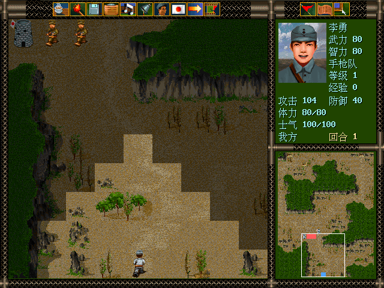
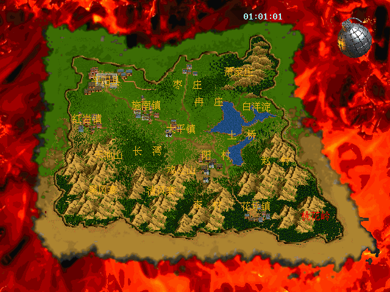

# dlz-remake

《抗日：地雷战》（1998）的非官方 Godot 重实现：用 GDScript 实现战斗、战役、城镇与界面，用 Python 解析本地原版数据并准备运行资源。

**这是开发中的桌面项目，不是原版游戏资源包，也不是官方作品。** 运行需要有权使用的原版文件；Git 仓库不包含原版数据，获取入口见下方[原版数据](#原版数据)。已有 47 关的数据与流程支持；本地用户实玩存档已确认 **前23关通关，第24关进行中**。尚不代表47关全部验证完成。

[玩家攻略](docs/guide/README.md) · [离线攻略](docs/guide/guide.html) · [地形图鉴](docs/guide/terrain.md) · [兵种范围](docs/guide/unit_ranges.md) · [数值参考](docs/guide/reference.md) · [关卡事件](docs/guide/missions.md)

## 当前实现

- 回合制战斗：移动、攻击、策略、地雷、物品、装备、士气、经验与敌方 AI。
- 战役与城镇：关卡部署、招募、商店、锻造、转职、库存及战报结算。
- 原版数据解析、像素界面、剧情、音效与过场的本地转换管线。
- 本项目存档及部分原版存档读取；**不支持原 EXE mode150 战中续战**，不承诺所有旧存档兼容。
- 规则、数据和界面的回归测试，以及独立的新档路线验证工具。

已知限制：后续主线、隐藏分支与全关通关尚未验证完成；仍可能出现战役阻塞或规则差异。回归测试验证规则和界面一致性，不能替代后续关卡的实际通关记录。

## 逆向与重实现成果

| 战斗、移动范围与小地图 | 战略地图与城镇 |
|---|---|
|  |  |


- **格式解析**：DAT/IMG 等文件已转成可检查的 JSON、精灵图集、地图、音频与字体资产。
- **规则还原**：攻防/成长、16种策略、地雷机制、物品库存与存档边界，以原始数据和静态逆向证据交叉核对。
- **流程重建**：47关模板、19城镇、剧情事件、部署、商店与战报在 Godot 中重实现；数据覆盖与实际通关数分别记录。

上图为既有重实现回归截图与本地解码图集，**不是玩家存档截图，也不构成全关验收证据**。图中原版美术/字形不适用 MIT，详见[展示图说明](docs/images/README.md)。

## 已验证可玩进度

截至2026-10-30，已只读核对7个本地存档槽位：普通难度完成列表连续覆盖 **L00–L22，即前23关**，每关评分与总分一致；第24关 **“营救彼德”（L23）** 有未结束的非演练战斗续存。

这作为**用户实玩通关记录**计入项目可玩性依据，不能把当前第24关算作已经通关，也不将多个槽位的关数相加。原始存档不上传，仅保留[实玩进度摘要](docs/validation/manual_progress.json)；这项人工实玩证据与自动全关回归门槛分开，不声称完成47关或全部分支。

## 环境

目前以 **macOS + Godot 4.7.2** 为开发验证环境；其他桌面系统未在本说明中承诺通过。

- Godot 4.7.2（项目使用 GL Compatibility 渲染器）。
- Python 3.10+，Python 包 `Pillow`、`numpy`。
- `ffmpeg`、`ffprobe`：音轨和过场转换需要；完整过场管线需要 FFmpeg 支持 `libvpx-vp9`、`libvorbis`、`libtheora`。
- 原版安装目录，包括 DAT、IMG、TGA、字体、动画/视频文件，以及音效光盘 NRG。

## 原版数据

- 文件：`anti-jap-original-data.zip`（约 768 MiB）。
- [百度网盘下载](https://pan.baidu.com/s/1VdD0rDb_Sr08U2qkaryJhQ?pwd=i7hm)，提取码：**`i7hm`**。
- 也可扫描二维码打开分享：

<a href="https://pan.baidu.com/s/1VdD0rDb_Sr08U2qkaryJhQ?pwd=i7hm"></a>

压缩包内含顶层 `ANTI-JAP/` 目录；解压到仓库旁的 `../dlz/` 后，应得到 `../dlz/ANTI-JAP/GAME.DAT` 等文件，再按下文准备运行资源。原版数据不适用本项目 MIT 许可，请仅在有权使用的前提下获取和使用；不要将压缩包或解压文件提交到 Git。

## 首次运行

以下命令均在仓库根目录执行。当前多个生成器仍约定原版目录为 `../dlz/ANTI-JAP/`，推荐采用这个目录布局（目录中保留原版文件名和层级）：

```text
workspace/
├── dlz-remake/                  # 本仓库
└── dlz/
    └── ANTI-JAP/                # 自行准备的本地原版文件
        ├── GAME.DAT
        ├── TXT.DAT
        ├── HZK16
        ├── ASC16
        ├── …
        └── ISO/
            └── 抗日地雷战音效光盘.nrg
```

原版位于其他位置时，可以将 `../dlz/ANTI-JAP` 建为指向该目录的符号链接。请勿把原版文件复制进仓库。`DLZ_GAME` 目前仅被部分脚本读取，**不能**用它统一改写整个管线的资源路径。

```bash
python3 -m venv .venv
source .venv/bin/activate
python3 -m pip install Pillow numpy

# macOS 默认值；其他位置请改为自己的 Godot 可执行文件。
export GODOT_BIN="/Applications/Godot.app/Contents/MacOS/Godot"

# 媒体工具默认从 PATH 查找；以下变量可显式指定其他构建。
export M5_FFMPEG="$(command -v ffmpeg)"
export M5_FFPROBE="$(command -v ffprobe)"
export M5_FFMPEG_THEORA="$M5_FFMPEG"  # 若该构建无 libtheora，改为支持它的 ffmpeg

# 1. 从原版数据生成 data/ 和 out/。
python3 extract_all.py
# 2. 首次准备视频/动画；会花费一定时间和磁盘空间，重复执行会复用缓存。
python3 tools/prepare_m5_media.py
# 3. 准备 Godot 数据、图像、音轨和字体，然后启动。
./run_game.sh
```

`run_game.sh` 不负责首次 `extract_all.py` 和媒体转换，不能在空资源目录中直接运行。启动及数据转换使用重写后的程序，不需要运行原版 EXE。

生成目录 `out/`、`data/`、`assets/`、`godot/data/`、`godot/assets/` 和 Godot 导入缓存均被 Git 忽略。转换不会改变原版资源的权利归属，**不要把包含原版资源的生成目录或导出包直接当作 MIT 项目发布**。

## 操作与存档

- 鼠标左键选择、移动或确认；右键 / `Esc` 取消。
- `WASD` / 方向键平移战场；更多操作见[玩家攻略](docs/guide/README.md)。
- `./run_playtest.sh` 开启试玩日志，`F8` / `F9` 导出局面；日志和存档使用 Godot 的 `user://` 用户数据目录，不应提交到 Git。
- 附加开发入口需要显式传参，不属于正常战役流程：

```bash
./run_game.sh -- --remake-tools=drill
# 可选：drill / story / settings / intro / gallery
```

## 验证

无需原版资源的合成数据单元测试：

```bash
PYTHONPATH=tools python3 -m unittest test_campaign_routes test_campaign_evidence test_repair_yulai_save
```

准备好完整运行数据后：

```bash
python3 verify.py                 # 原版数据/解析器检查
./verify_original.sh             # 当前规则回归；不等于全关验收
./verify_original.sh --ui        # 增加界面截图检查
./verify_final.sh                # 严格路线门槛，未满足全关条件时非零退出
```

`--legal` 在测试器中表示按游戏权限进行路线验证，**不是版权或法律审查**。最终门槛失败不能通过修改数值、复用旧证据或开发档绕过。

## 目录与开发

| 路径 | 用途 |
|---|---|
| `godot/scripts/` | 游戏运行逻辑、界面、战役与存档 |
| `godot/tests/` | 规则、界面和路线测试 |
| `extract/*.py`、`extract_all.py` | 原版格式解析与数据抽取 |
| `tools/` | 资源准备、回归检查、攻略生成与辅助工具 |
| `docs/guide/` | 当前实现对应的玩家文档 |
| `extract/contracts/` | 构建和测试所需的精简事实契约与测试向量 |

修改生成数据时应修改生成器，而不是直接编辑输出 JSON。新增中文界面文字后运行 `python3 tools/rebuild_font.py`。提交前请检查差异，避免加入存档、日志、绝对用户路径、密钥、签名文件或无权发布的材料。

## 许可证与来源

本项目有权授权的重写代码及原创文档采用 **[MIT License](LICENSE)**，允许商业使用与修改分发，需保留许可及版权声明；不提供担保。

MIT **不覆盖**展示图、原版游戏文件及其提取/转换资源、内嵌原版图像、字体字形、原版反汇编/反编译摘录、第三方内容或商标。项目名也不表示获得原权利人授权。具体边界和已知参考来源见 [THIRD_PARTY_NOTICES](THIRD_PARTY_NOTICES.md)。

作者：[Sinix512](https://github.com/Sinix512)。格式研究参考了 [dlzopen/dlz_research](https://github.com/dlzopen/dlz_research)；相关文件保留来源说明及上游 MIT 许可。
